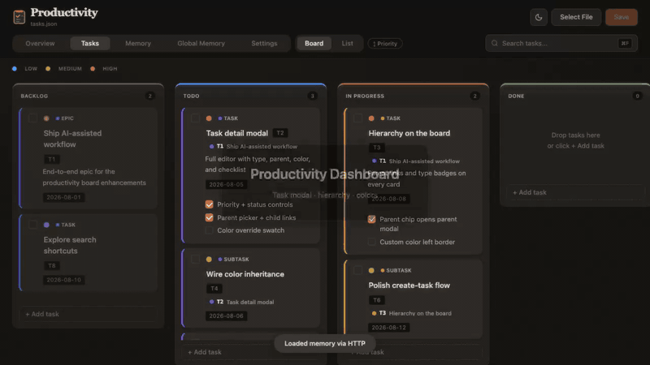
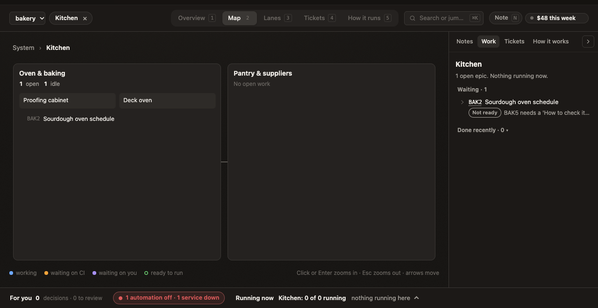

# Claude Code Productivity Dashboard

A modular, local-first productivity dashboard designed for [Claude Code](https://docs.anthropic.com/en/docs/claude-code). Manage tasks on a Kanban board, maintain contextual memory files, and automate daily standups — all from your browser, with real-time sync to your filesystem.

> Based on Anthropic's [productivity plugin](https://github.com/anthropics/knowledge-work-plugins/tree/main/productivity), with significant enhancements.

[](LICENSE)



## Key Enhancements Over Upstream

| Feature | Upstream Plugin | This Dashboard |
|---------|----------------|----------------|
| Dashboard | Single monolithic HTML file | Modular JS + CSS |
| Server | None (FileSystem API only) | Custom Node.js server with REST API |
| Task Board | Basic | Kanban with priorities, types, due dates, labels, filters, swimlanes, keyboard, bulk actions |
| Task Editing | External only | Detail + create modals (hierarchy, due, blocked, estimate, assignee, links, history) |
| Hierarchy | None | Epic → Task → Subtask with parent/child navigation |
| Colors | None | Per-type defaults, parent inheritance, optional per-task override |
| Memory Management | Read-only display | Full CRUD with modal editor + inline editing |
| Search | None | Full-text search + faceted task filters |
| Theme | None | Dark-first design with light mode toggle |
| Views | Single view | Board view + list view |
| Overview | None | Sprint tracker, deadlines, blocked count, estimate total, deep links to Tasks |
| Automation | None | Daily summary (LaunchAgents running OpenCode — see Automations) |
| Config | Hardcoded | External `config.json` (links, sprints, WIP limits, Slack) |
| Global Memory | None | Global sidebar tab under Memory — view/edit Claude's cross-project memory |

## Quick Start

```bash
# Clone the repository
git clone https://github.com/Diabl0269/productivity-dashboard.git
cd productivity-dashboard

# Set up your personal configuration
cp config.example.json config.json
cp tasks.example.json tasks.json
cp CLAUDE.md.example CLAUDE.md
cp -r memory.example/ memory/

# Edit config.json with your links, sprint schedule, and optional wipLimit
# Edit CLAUDE.md with your team info and context
# Prefer `ch tasks` (see cli/README.md) over editing tasks.json by hand

# Start the dashboard
node serve.js
# Open http://127.0.0.1:3000/dashboard/
```

**Prerequisites:** Node.js v14+ and a modern browser. The server binds to loopback only.

### Start at login (macOS)

```bash
node scripts/dashboard-daemon.mjs enable
node scripts/dashboard-daemon.mjs status
node scripts/dashboard-daemon.mjs disable
```

The LaunchAgent starts at login, restarts after a crash, and logs to
`~/Library/Logs/productivity-dashboard/`. Re-run `enable` after moving the checkout or switching
Node versions. The daemon restarts itself when server code (`serve.js`, `server/`, `shared/`, `cli/lib/`) changes, e.g. after `git pull`; re-run `enable` once after upgrading to get this. Static HTML/CSS/JS changes are served
directly and only need a browser refresh. If `CH_HOME` is set, the daemon preserves that data root.
Set `DASHBOARD_PORT` when enabling on a non-default port.

## Configuration

### config.json

Controls Overview widgets and soft WIP limits. Copy `config.example.json` and customize:

```json
{
  "quickLinks": [
    { "icon": "📊", "label": "Jira Board", "url": "https://..." }
  ],
  "externalTabs": [
    { "label": "Status page", "url": "https://example.com/status", "mode": "iframe" },
    { "label": "Docs", "url": "https://example.com/docs", "mode": "link" }
  ],
  "sprints": [
    { "name": "Q1 S1", "start": "2026-01-01", "end": "2026-01-21" }
  ],
  "wipLimit": 5,
  "wipLimits": { "in-progress": 5 },
  "defaultWorkshops": [
    { "name": "Team Workshop", "status": "planned" }
  ]
}
```

- `wipLimit` — soft max cards for In Progress (board header warning when exceeded)
- `wipLimits` — optional per-section overrides (same soft-limit behavior)
- `externalTabs` — adds extra tab buttons pointing at any URL you run yourself (a local
  dashboard, an internal tool, etc.). Each entry is `{ label, url, mode }`: `mode:
  "iframe"` embeds the URL in the main area (with its own deep-linkable tab route),
  `mode: "link"` opens it in a new browser tab instead. Loopback iframe URLs automatically
  use the dashboard's hostname (`localhost` or `127.0.0.1`) so browsers treat the dashboard and
  embedded app as same-site. Malformed entries (missing `label`/`url`, or an unrecognized
  `mode`) are skipped. Omit the key for no extra tabs.

Full task CLI and `tasks.json` field reference: [`cli/README.md`](cli/README.md).
### CLAUDE.md

Your project's context file — Claude Code reads this to understand your team, terminology, projects, and processes. Copy `CLAUDE.md.example` and fill in your details.

### memory/

Directory of markdown files that store persistent context:
- `memory/glossary.md` — Acronyms and internal terminology
- `memory/people/` — Team member profiles
- `memory/projects/` — Project documentation
- `memory/context/` — Company and organizational context

See `memory.example/` for the expected format.

## Features

### Kanban Board
- **Columns:** Backlog, Todo, In Progress, Done, Archive
- **Drag & Drop:** Move tasks between columns
- **Priority Indicators:** Clickable dots — blue (low), yellow (medium), red (high)
- **Type Badges & Colors:** Epic / Task / Subtask badges with colored left borders (inherit from parent or override)
- **Due Dates:** First-class `dueDate` with urgency styling on cards; Overview deadlines prefer this field
- **Blocked / Waiting:** Flag tasks as blocked with optional free-text `waitingOn`; peer deps via `blockedBy`
- **Labels & Links:** Free-form tags and external URL links on tasks
- **Assignee:** Free-text name/slug (`assignee`); filterable
- **Time estimate:** `estimateMinutes` (integer minutes) — display as `30m` / `2h` / `1d` (1d = 8h). Not story points.
- **Activity log:** Lightweight `history` entries on moves / priority / blocked / assignee / estimate
- **Bulk select:** Checkbox or ⌘/Ctrl-click; bulk move, priority, archive, label, block, delete
- **Undo delete:** Soft-delete with Undo toast (~7s)
- **Swimlanes:** Toggle to group board by parent epic
- **Keyboard:** `n` new, `j`/`k` navigate, `h`/`l` move columns, `1`/`2`/`3` priority, `Enter` detail, `x` select, `⌫` delete, `Esc` clear (press `?` for hint)
- **Faceted Filters:** Priority, type, due, parent, blocked, section, label, assignee pills (AND with text search)
- **WIP Limits:** Soft In Progress limit via `config.json` (`wipLimit` or `wipLimits`)
- **Parent Links:** Cards show a parent chip that opens the parent in the detail modal
- **Task Detail Modal:** Full record including estimate, assignee, activity timeline
- **Create Modal:** `+ Add task` opens a full create form with hierarchy and color controls
- **Auto-sync:** Polls `tasks.json` every 2 seconds for external changes

### List View
- Flat list of all tasks with status, priority, type, parent links, due/blocked badges, and notes
- Alternative to the board for quick scanning

### Ticket Types (Settings)
- Configure types with colors and **which types can be parents** (Link under checkboxes)
- A Bug can link under Epic or Task, or stay standalone — not forced into a single linear chain
- Add, rename, reorder, or remove types in Settings → Ticket Types (saved to `tasks.json`)
- Colors flow onto cards, parent chips, and the detail/create modals

### Checks Tab
- Lists every ticket that still has a check (or a needs-tal line) only you can tick, as the same check rows the Plan page shows, oldest first, with the checks open. **Hide finished** (on by default, remembered in the browser) hides tickets whose checks are all ticked; turn it off to see them, and the ones that closed in the last 7 days. Arrow Up/Down, Home and End move between tickets. Data: `shared/open-checks.js`.

### Plan Tab
- Shows which pinned epics (`ch tasks plan --pin <id>`; epics with a lane pin themselves and unpin once their last ticket closes) can be launched now, as horizontal lanes that run side by side (set an epic's lane with `ch tasks update <id> --lane <slug>`); cards in a lane run left to right
- A card or review item whose ticket has a link labelled `Thread` (`ch tasks update <id> --add-link <thread url> --link-label Thread`) shows an **Open thread** link to the Claude thread working on it
- A dashed divider splits each lane into what can run now and what comes later, and names what it waits on ("after your pick T12", "after E4"); each id opens that ticket. `Co-task:` tickets are yours: ones with "pick" in the title or a `design` label get a design canvas in the Design round lane, other co-tasks show as a to-do card there. Lane names show capitalized ("timeline" reads Timeline), and each lane head counts its epics and open tickets
- Each card shows an In progress chip (the epic, or an open ticket in it, is in the In progress column) or a Ready now / Partly ready / Later / Not ready chip (one rule with the Ready state below: an epic Not ready there never says Ready now; an epic whose only open tickets sit in backlog says `Not ready: waits on <id> in backlog`), why it waits, a copy button for `/ship-task <id>`, and a Start / Started / Done toggle (remembered in this browser). The card's id opens the ticket in place. **Later cards that are Ready (PRO144):** a card in a lane's later row whose epic is Ready shows a `Ready · Auto` (or `Ready`) chip and the line `Ready · Auto: starts when <id> finishes` (a soft wait, not a block); an epic still on File review's stub description shows a `Not refined` chip and a `Copy refine prompt` button (`isStubEpic` in `shared/epic-ready.js`)
- Every ticket needs a project: `ch tasks add` and `capture` refuse without `--project <slug>` (the error lists the valid ones) unless `--no-project` marks a personal task; a child made with `--parent`/`--review-of` inherits its parent's project, and the dashboard's New task form requires a project or the "No project" tick.
- An epic's `model:` label (opus, sonnet, haiku or local) is the model that orchestrates it; `ch tasks add --type epic` refuses without one, `ch tasks lint` warns about open epics lacking it, and the Plan cards show it as "Orchestrator: Opus".
- Every epic needs a lane (`ch tasks add --type epic` refuses without `--lane`, the dashboard's New task form asks for one, `ch tasks lint` warns about open epics without one).
- Ready-for-review cards start collapsed (click the checks chip to open one). When review notes are open, the bar above the cards lists them (Show notes), files them into each area's next epic (File review) or hands them to Claude; the manual-only `/process-review-notes` skill does the same sweep from a session.
- Cards in a lane run in order; in "No lane yet" epics with no dependency between them are stacked in one column and can run at the same time. The first pill shows how many app builds could start now
- **Ready state:** the Plan page and `ch tasks runplan` list every open epic as Ready, Ready · Auto, or Not ready with the reason (in backlog, a "later" bucket, a pick or co-task open, a ticket missing How to check it, blocked). An epic runs automatically only when it is Ready AND Auto is on for it (label `auto`: the Auto box in the epic's ticket window, an Auto switch on every Plan page lane card and Ready row (Not-ready epics are folded under one "N not ready" button), or `ch tasks update <epic> --add-label auto`). Lanes hold every in-progress or Ready epic plus the pinned ones; pins mean this week's focus (an epic pins itself when it moves to in-progress; `ch tasks plan --pin <id>` pins by hand, `ch tasks plan --cleanup-pins [--dry-run]` drops the rest). List it with `ch tasks ready [--json] [--auto] [--apply-auto [--dry-run]]`. **Waits only on you (PRO138):** an epic that blocks another counts as done for the wait when every open ticket under it waits on Tal (a pick or co-task, `waitingOn`, a dated wait, backlog or inbox, a held label; none runnable, none in progress), and the list says `Runs now: <ids> only wait on you` (`softBlockers` in `--json`; a wait loop between epics stays a hard wait, a non-epic blocker stays hard, a ticket's own `blockedBy` is unchanged). A pick or co-task holds the whole epic only when no other ticket under it is free to run (otherwise only its dependents wait; `waitingPicks` in `--json`). `--apply-auto` does the housekeeping in one go: it closes every ticket in review with all checks ticked and nothing held (no unsent note, no open ask, no `needs-tal:` line; prints `closed <id>: every check ticked`), moves parked backlog tickets under an open epic (todo or in progress, not a later bucket) to todo, then adds `auto` to every Ready epic without it (never one labelled `no-auto`), one line per change; `--dry-run` prints the same lines and writes nothing. `ch tasks update <id> --parent <epic>` also moves a backlog ticket to todo when the new epic is open. Answering an ask that links a check closes the review it finished (shared `closeIfReviewComplete`). **Auto queue:** each epic has an Auto priority (High, Normal, Low: the epic window, or `ch tasks update <epic> --auto-priority <p>`) and the Plan page's Auto queue lists every Auto epic by priority; drag a row, or focus it and press Alt+Up / Alt+Down, to set the exact order (`--auto-rank`); `ch tasks ready` lists Auto epics in that order
- **Next start:** above the Auto queue the Plan page says what autorun starts next and when (`Next start: E2 (title) at today 14:30`), or why nothing does (paused, usage limit until a time, no free run slot, review cap, lane busy). Same text from `ch tasks next-start [--json]`; rules in `shared/next-start.js`, mirroring the dispatcher's gates, reading its `tick.json` for the last tick and live runs.
- **Later (N):** every other open epic (backlog, a "later" bucket, not ready) shows folded at the end of its lane (or under "No lane yet") as `Later (N)`, each with one plain line on why it can't start and what clears it; Auto never starts them. `ch tasks runplan` prints the same group
- **Why not ready (PRO85):** a Not-ready or Later card names what is missing in plain words (`FRO1507 needs a 'How to check it' line (in its In plain words section)`), every ticket id in it is a button, and with more than one reason a "What's missing (N)" list opens under it. A card whose epic is in backlog, or whose only open tickets are in backlog, has a "Move N backlog tickets to To do" button (click once, then Yes; Undo in the toast puts them back). It moves only that epic's own backlog tickets and never a "later" bucket. CLI twin: `ch tasks promote <epicId>`.
- **Completeness line (PRO84):** the Plan page and `ch tasks runplan` say `All 73 open epics are shown (179 finished ones are not)`; if an open epic is ever missing the line turns warn-coloured and names it. `runplan --json` carries `totals`.
- Same data from the CLI: `ch tasks runplan` (`[running]` marks in-progress cards, `‖` a card that runs alongside the one above)
- Start on a card also opens the selected AI provider (Claude Desktop via `claude://code/new`, or Antigravity CLI `agy -i` in Terminal when Gemini is selected in Settings) with the card's `/ship-task` command. Set `claudeSessionFolder` in `config.json` (or Default folder in Settings) to choose the folder it opens in.

### Home Tab

One project on one page: an Overview, a Map of the project's places you can zoom into, Lanes, a Tickets
table and How it runs (automations and services), with an inspector, a usage chip and a running-work strip.
Automation rows have an **Edit** panel for schedule, model, skill, prompt, enabled state and description. Its URL
keeps the project and automation (`/dashboard/home/how-it-runs/edit/<id>?hproject=<slug>`), and
`/dashboard/automations` opens the table directly. Each project describes its map in its own
`home.config.json`; start from `home.config.example.json` (a made-up bakery). A project can also list a markdown file as a `queues` card on the Overview (drag or `Alt+Up/Down` to reorder, edit a line, drop with undo). Full guide:
[docs/home-page.md](docs/home-page.md).



### Memory Viewer
- Browse all memory files organized by directory
- View detailed content of people, projects, and context files
- Inline edit fields and table cells directly
- Modal editor for adding/updating people and project records

### Overview Tab
- **Sprint Tracker:** Progress bar for current sprint (configured in `config.json`)
- **Task Summary:** Counts for in-progress, todo, done, and blocked — click to open Tasks with that filter; total time estimate for active work
- **Today Plan:** Filter (Pinned / Epics in progress / Both, default Both) over `ch tasks plan --pin` tickets and in-progress epics, with done/total progress on epic rows; the choice is remembered in localStorage
- **Autorun:** Edits `$CH_HOME/autorun.json` (max runs, max total, pace stop, review cap, max starts, finished idle minutes; blank = default, blank max total = ignore manual sessions) and the `autorun.off` kill switch the autorun dispatcher reads every tick
- **Upcoming Deadlines:** Prefer `dueDate`; fall back to dates scraped from descriptions
- **Quick Links:** Configurable shortcuts to your tools (Jira, Notion, Slack, etc.)
- **1:1 Topics:** Scratchpad for manager meeting topics
- **Workshops:** Track workshop status (planned, in-progress, done)

### Dark/Light Mode
- Dark theme is the default; toggle to light in the top-right corner
- Preference saved to localStorage
- Both themes share a single design-token system (`dashboard/styles/base.css`)

## Automations (macOS LaunchAgents)

Recurring jobs (`daily-summary`, `weekly-performance-review`, `ai-ideas-watcher`, `insights`) run as macOS LaunchAgents
`local.agent-automation.<id>` (and legacy `local.opencode.<id>`) that call `scripts/launchagents/run-job.sh` with the configured harness (`gemini` / `agy`, `opencode`, `claude`, `codex`, `copilot`, or `custom`)
and record each run in `~/Library/Logs/agent-automations/<id>.last.json` and `<id>.runs.jsonl`.

```bash
REPO_ROOT="/path/to/checkout" AUTOMATION_HARNESS="gemini" AUTOMATION_CLI="agy" node scripts/launchagents/install.mjs
```

Jobs, defaults, and schedules live in `home.config.json` (falling back to `scripts/launchagents/jobs.json` schedules), writes the plists
(`plutil`-linted) and loads them with `launchctl bootout` + `bootstrap gui/$UID`.

The dashboard **Automations** tab and **Home → How it runs** (`/dashboard/automations`) manage LaunchAgents: schedule, harness/model/effort, program arguments, environment, the
script it runs, Run now, Enable/Disable, log tail, and Open session (`gemini`: `agy --conversation=<id>` in Terminal; `claude`/`codex`: Terminal resume in the job's working directory; `opencode`/`copilot`: opens the app or attaches in Terminal via Open in Terminal;
other: the log file). API: `server/automations-routes.js` (`/api/automations*`, local-origin only).

| Env var | Purpose |
|---|---|
| `LAUNCH_AGENTS_DIR` | LaunchAgents directory (default `~/Library/LaunchAgents`) |
| `AUTOMATION_LOG_DIR` | Logs, `<id>.last.json`, and `<id>.runs.jsonl` sidecars |
| `REPO_ROOT` | Checkout the jobs run in (installer; default this repo) |
| `AUTOMATION_HARNESS`, `AUTOMATION_CLI`, `AUTOMATION_MODEL`, `AUTOMATION_EFFORT` | Harness, CLI binary, model, and effort for `install.mjs` / `run-job.sh` |
| `GEMINI_CLI`, `OPENCODE_CLI`, `OPENCODE_MODEL` | Per-harness CLI / model overrides |
| `LAUNCHCTL_BIN`, `PLUTIL_BIN`, `OPEN_BIN`, `OSASCRIPT_BIN`, `LAUNCHD_UID` | Overrides for tests |

## Daily Automation (macOS LaunchAgent)

Automate daily productivity summaries that run every morning and send you a Slack DM with findings from Jira, Notion, Slack, and your memory files.

### Setup

1. Copy and customize the script:
   ```bash
   cp scripts/daily-update.sh.example scripts/daily-update.sh
   chmod +x scripts/daily-update.sh
   # Edit the CUSTOMIZE THESE section at the top
   ```

2. Create the LaunchAgent plist:
   ```bash
   cat > ~/Library/LaunchAgents/com.claude.daily-update.plist << 'EOF'
   <?xml version="1.0" encoding="UTF-8"?>
   <!DOCTYPE plist PUBLIC "-//Apple//DTD PLIST 1.0//EN" "http://www.apple.com/DTDs/PropertyList-1.0.dtd">
   <plist version="1.0">
   <dict>
     <key>Label</key>
     <string>com.claude.daily-update</string>
     <key>ProgramArguments</key>
     <array>
       <string>/bin/bash</string>
       <string>/path/to/your/scripts/daily-update.sh</string>
     </array>
     <key>StartCalendarInterval</key>
     <dict>
       <key>Hour</key>
       <integer>9</integer>
       <key>Minute</key>
       <integer>0</integer>
     </dict>
     <key>StandardOutPath</key>
     <string>/tmp/claude-daily-update-launchd.log</string>
     <key>StandardErrorPath</key>
     <string>/tmp/claude-daily-update-launchd.log</string>
     <key>WorkingDirectory</key>
     <string>/Users/YOUR_USERNAME</string>
   </dict>
   </plist>
   EOF
   ```

3. Load the agent:
   ```bash
   launchctl load ~/Library/LaunchAgents/com.claude.daily-update.plist
   ```

4. Verify it's scheduled:
   ```bash
   launchctl list | grep claude
   ```

To unload: `launchctl unload ~/Library/LaunchAgents/com.claude.daily-update.plist`

### What the Daily Update Does

1. Runs `claude -p` non-interactively with the `/productivity:update --comprehensive` command
2. Gathers data from Jira, Notion, Slack, and your memory files
3. Compiles a structured report
4. Sends a Slack DM with findings (new tickets, missed action items, stale tasks)
5. Includes a resume command so you can follow up interactively

## Metrics

Where does work wait? `ch metrics` measures it locally from ticket history, Claude Code transcripts,
GitHub Actions runs and local gate logs. Details, config and definitions: [docs/metrics.md](docs/metrics.md).

On the Metrics page: **Review wait** measures epic review cards (median, p90, how many wait now and the oldest);
**Ready to first look** is the distribution of time from moving to Review until the card moves again or gets a review note;
**Reopened** counts moves back from Review/Done plus fix tickets opened from a shipped ticket within 14 days, by model label;
**Per shipped ticket** includes archived tickets and says how many it covers (n of N), with a per-closed-epic cost beside it;
the Sessions and Cost sections show one cost total and session count. **Session health** replaces the separate stuck, silent and
autonomy cards: every session is stuck, silent, asked you, or clean, with the no-cause stops split by what woke the session and by week,
and an action line per card. **Backlog** shows tickets created vs shipped per week, closed-without-work, and warns when created beats
shipped for 3 weeks. **Quality** shows review notes by taste principle, rework by model label and red CI runs per PR, each with a
"when high, do this" line. The **Month at API prices** card needs
`metrics.planUSDPerMonth` in `config.json` (your monthly plan price, a number; left `null` in `config.example.json`). Without it the card says to set it.

```
ch metrics collect [--sessions] [--ci] [--gates] [--since 30d] [--json]
ch metrics flow    [--project P] [--lane L] [--since 30d] [--json]
ch metrics report  [--project P] [--since 30d] [--json]
ch metrics cost [<id>] [--project P] [--since 30d] [--json]
ch metrics estimate [<id>] [--project P] [--json]
ch tasks sweep-idle [--hours 24] [--dry-run]   move in-progress tickets with no session work for 24 h back to todo
ch metrics estimate --accuracy [--project P] [--json]   # backtest: how close Likely cost was to real cost
ch metrics time <name> [--repo R] -- <command...>
ch metrics record --name N --seconds S [--ok|--failed] [--repo R] [--kind gate|build|test|ci|other]
```

## Claude Desktop / Claude Code Integration

### Basic Setup

1. Open the project directory in Claude Code (CLI, Desktop, or IDE extension)
2. Claude will automatically read `CLAUDE.md` and `memory/` files for context
3. Use `/productivity:start` to initialize the system on first run
4. Use `/productivity:update` to sync tasks and refresh memory

### Scheduling via Claude Code (`/schedule`)

Claude Code has a built-in `/schedule` command that creates recurring remote agents — no LaunchAgent or cron needed:

```bash
# Schedule a daily productivity update at 9:00 AM
/schedule create --cron "0 9 * * 1-5" --name "daily-update" --prompt "Run /productivity:update --comprehensive. Gather all data from Jira, Notion, and Slack. Compile a structured report and send a Slack DM to user YOUR_SLACK_USER_ID with the findings. Do not ask questions or wait for input."
```

Manage your scheduled agents:
```bash
/schedule list          # View all scheduled agents
/schedule run <name>    # Run one immediately
/schedule delete <name> # Remove a scheduled agent
```

This is the simplest option — it works across macOS, Linux, and Windows with no OS-specific configuration.

### Scheduling via Claude Desktop App

You can also manage scheduled agents through the Claude Desktop app UI:

1. Open **Claude Desktop** → **Settings** → **Scheduled Agents**
2. Click **Create New** and configure:
   - **Name:** `daily-update`
   - **Schedule:** Weekdays at 9:00 AM (or your preferred time)
   - **Working Directory:** path to this project
   - **Prompt:** your update instructions (see example above)
3. The agent runs automatically on schedule and you can view run history in the app

## Project Structure

```
.
├── config.example.json          # Dashboard config template (includes wipLimit)
├── CLAUDE.md.example            # Project context template
├── tasks.example.json           # Canonical tasks.json template
├── TASKS.md.example             # Legacy markdown snapshot template
├── serve.js                     # Zero-dependency Node.js dev server
├── dashboard/
│   ├── index.html               # Single-page app shell
│   ├── js/
│   │   ├── main.js              # Entry point, config loading
│   │   ├── tasks-json.js        # tasks.json load/save
│   │   ├── tasks-board.js       # Kanban board rendering
│   │   ├── tasks-list.js        # List view rendering
│   │   ├── tasks-io.js          # Task file I/O
│   │   ├── tasks-main.js        # Task rendering coordination
│   │   ├── task-fields.js       # Shared field helpers (due, estimate, …)
│   │   ├── task-filters.js      # Faceted board/list filters
│   │   ├── memory-parser.js     # Memory file parsing
│   │   ├── memory-renderer.js   # Memory tab UI
│   │   ├── memory-modal.js      # Modal editor for memory
│   │   ├── inline-edit.js       # Click-to-edit fields
│   │   ├── http-loader.js       # HTTP API integration
│   │   ├── state.js             # Shared app state
│   │   ├── overview.js          # Overview tab widgets
│   │   ├── autorun-card.js      # Overview Autorun card (autorun.json + kill switch)
│   │   ├── search.js            # Full-text search
│   │   ├── global-memory.js     # Cross-project memory
│   │   ├── persistence.js       # IndexedDB + FileSystem API
│   │   └── theme.js             # Dark/light mode
│   └── styles/
│       ├── base.css             # Core layout and typography
│       ├── tasks.css            # Task board and list styles
│       ├── memory.css           # Memory viewer styles
│       ├── modal.css            # Modal dialog styles
│       ├── overview.css         # Overview tab styles
│       ├── global-memory.css    # Global memory styles
│       └── misc.css             # Utility classes
├── memory.example/              # Example memory directory
│   ├── MEMORY.md
│   ├── glossary.md
│   ├── context/company.md
│   ├── people/jane-doe.md
│   └── projects/example-project.md
└── scripts/
    └── daily-update.sh.example  # Automated daily summary template
```

## API Endpoints

The `serve.js` server provides:

| Endpoint | Method | Description |
|----------|--------|-------------|
| `/api/memory-manifest` | GET | Returns manifest of all memory files with content |
| `/api/save` | POST | Saves updates to `tasks.json` or memory files |
| `/api/global-memory` | GET | Reads Claude's cross-project global memory |
| `/api/global-save` | POST | Saves to global memory directory |
| `/api/note-image` | POST | Stores a note image (`{ticketId, dataBase64}`, png/jpg/webp/gif, max 8 MB) in `<CH_HOME>/attachments/<ticketId>/`; returns `{path}` |
| `/attachments/<ticketId>/<file>` | GET | Serves a stored note image |

Note images are paste-able or pickable in a ticket's note box; the files stay in `attachments/` next to `tasks.json` (outside git; `attachments/` is in `.gitignore` for the repo-local data dir). **They are not included in `ch tasks backup` / the dashboard backup: copy the whole data folder to back them up.** Deleting a note leaves its files on disk. Notes can be edited (pencil button) in the dashboard or with `ch tasks update <id> --edit-note N --note-text "..."`.

## File Formats

### tasks.json

Canonical task store (gitignored). Copy `tasks.example.json`. Full schema: [`cli/README.md`](cli/README.md). Large stores can be split into one file per ticket with `ch tasks split` (`tasks.d/`); the server assembles them so `/tasks.json` looks the same.

Notable optional fields: `dueDate`, `blocked`, `waitingOn`, `assignee`, `estimateMinutes` (minutes — **not** story points; display as `30m`/`2h`/`1d`), `labels`, `links`, `blockedBy`, `history`, `checks` (a check may carry `noProject`, the reason it has no project to open; the review gate requires a project or that reason) (per-ticket tick-list `{text, checked, addedAt, project?, video?}` (`project` / `video`: paths under `$CH_HOME/evidence`, see below), optional `agentVerified: {at, by, result: pass|fail, note}` set only by `ch tasks update T7 --verify-check N --verify-note "<how it was run>" [--verify-result pass|fail] [--verify-by name]` (never ticks the check by itself, but PRO111: an epic whose only unticked checks are passed and carry no video, audio, project or taste flag closes to Done with them ticked, on `review` of its last child or on the verifying `update`; taste, hardware and hearing checks stay Tal's tick; `--unverify-check N` removes it; the Plan page shows "Agent verified <date>" or "Agent: failed"; `ch tasks checks [--json]` lists unticked, not handed-off checks without one on open epics and in-progress/review tickets), separate from subtasks and never blocks done; `ch tasks update T7 --add-check "text" --check-check 1`), `result` (what shipped: `{at, shipped[], left?[], tests?[], ci}`) and `reviewOf` (the ticket whose review this one came from). Shipped work waits in the **Ready for review** column (`ch tasks review T7 --shipped "..." --check "..."`) and moves to Done when its last check is ticked (tickets under an epic fold their result and checks into the epic, so the column shows one card per epic; an epic also closes by itself when its last open child is done, moved out or ticked off). `review` needs a `--check` (or `--no-checks "<reason>"`). Evidence on a check: `--check-project N=<path>`, `--check-video N=<path>` `--check-audio N=<path>` and `--check-no-video N=<reason>` (repeatable; N is the 1-based `--check` of this call) attach a saved `.agsproj`, a short `.mp4` and a `.wav` (or `.mp3`/`.m4a`/`.ogg`/`.flac`) to it (`--check-no-video` instead gives a 3-200 character reason the check has no video, shown as a muted "No video: …" line; a check cannot carry both), shown as **Open project** / **Play video** / an inline audio player on the Plan page and in the ticket's review panel. The path is relative to `$CH_HOME/evidence` or absolute inside it, and must exist; `--result-json` `checks` items may be `{"text","project","video","audio"}` objects. On an existing check (any ticket, done or epic): `ch tasks update T7 --check-video N=<path>` (also `--check-project`, `--check-audio`, `--check-no-video N=<reason>`; repeatable; N is the 1-based check as `ch tasks get` lists it) attaches or replaces that evidence with the same rules, leaving the check's text and tick alone. The gate refuses checks a session can do itself, each refusal naming the fix: a placeholder "nothing to check" (use `--no-checks`), a measured result such as "Eval: ... cost $0.02" or "12 tests passed" (put it in `--tests`), a check telling the reviewer to run an eval, script or command (run it yourself, result in `--tests`), a file path or `*.wav`/`*.mp4`/`*.png`/`*.agsproj` name with nothing attached (attach it instead), and a check about AI-generated content without `--check-project` (create the project with the AI yourself). `--allow-check-owner` overrides. **Proof gate (ui/audio tickets):** on a ticket labelled `ui` or `audio` (or under an epic that is), every `--unverified` line must start with one of the allowed reasons, `taste:`, `hardware:`, `outside:` or `consent:` (optionally after `needs-tal:` / `tried:`, e.g. `needs-tal: taste: does the fade feel smooth`), and the review needs proof: `--evidence <path>` (any saved file under `$CH_HOME/evidence`, such as a screenshot, AX dump, render or run log; kept on the ticket as `reviewEvidence` and shown by `ch tasks get`), a check with a project/video/audio attached, or at least one tagged `--unverified` line. `--force "<why>"` overrides and records the reason on the ticket (`forcedReview`); a bare `--force` still only skips the open-subtasks rule. Checks sharing a project are grouped under one `Project: <name>` header. An epic's rolled-up check keeps both. **Open project** needs `serve.js` running: `POST /api/open-project` (same-origin only) runs `open -a <newest build> <bundle>`, picking from `reviewProjectApps` in `config.json` (a list of `.app` paths, newest `Contents/MacOS` mtime wins; empty = `open <bundle>`); **Open project on an unmerged PR (PRO101):** the request may carry `branch` (or `pr`, resolved with `gh pr view`); when it does, the build whose `reviewProjectApps` path contains that branch (the branch, slashes as `-`/`_`, or its last segment, e.g. a worktree's `.../pro95-plan-cards/.../Agent Synth.app`) opens, and with no such build nothing opens: the request answers 409 with `branchMissing`, and the card's buttons read "No build of branch X" (FRO2246: never main's build in its place). A review with `--held-pr` takes `--build-app <path to the branch's .app>`, stored as `heldPr.buildApp` and added to `reviewProjectApps`, and that exact build opens for the branch even when its path does not name it; on a `frontend` ticket a held review with no registered branch build is refused. Checks with `heldPr` and asks with `mergePr` send it, and an ask shows the same `on branch X (PR #n), not merged` chip as a check until the PR merges; then both go back to the newest build. List worktree builds in `reviewProjectApps` to make them findable. **Run site and open (WEB49):** config.json `branchSites` is a list of `{projects, command, url}` (`command` contains `{branch}`, `url` is on localhost); a held-branch check of a listed project gets a **Run site and open** button that replaces its app-build Open project button: `POST /api/branch-site` (same-origin only) writes `$CH_HOME/run/branch-site-<branch>.command` (branch single-quoted in `command`), opens it in Terminal (logs visible; a site already on the port is refused, 409), and the dashboard opens `url` in a new tab once `GET /api/branch-site/ready` says its port answers (4 minutes at most); see `config.example.json`. videos, sounds and screenshots stream from `/evidence/<rel>` with Range support. Each Ready-for-review card can say whether your installed app has the change: config.json `buildFreshness` is a list of `{repo, prPattern, buildCommit, updateCommand}` rules (see `config.example.json`). For a ticket with a link containing `prPattern` + a PR number, `serve.js` (`GET /api/build-freshness?url=`) finds the PR's merge commit in `repo` with `git log --grep "(#N)"` (local git only, no network), reads the installed build's commit from `buildCommit` (`{plist, key, tag?}`, `{file}` or `{command}`; `tag: "v{value}"` maps a version string to its release tag), and runs `git merge-base --is-ancestor`. The card then shows `Your app: in your build`, or `Your app: needs a newer build (merged 7 Nov, your app is from 14 Sep). Update: <updateCommand>`. An epic card has no links of its own, so it checks its children's PR links and shows the worst state, naming the tickets that are behind (`Your app: needs a newer build (...). Behind: FRO1474, FRO1611. Update: <updateCommand>`). When a rule matches but the state cannot be read, the card says `No build info for this change`; a ticket without a matching PR link shows nothing. `done`, `move … done` and `review` refuse a ticket with unchecked subtasks unless `--force`, and `ch tasks update T7 --promote-subtask N` turns subtask N into its own task (the dashboard's **Make task** button on each subtask row does the same; the dashboard saves the whole file, so there is no separate tasks API: `shared/subtasks.js` is the shared function); the Run plan tab lists it oldest first.

**Turnkey checks (FRO2246):** with the project gate on, `ch tasks review` also refuses, each with the fix: a check on a ticket labelled `ai` (or under an `ai` epic) with no project or audio, whatever its wording; a check with no `--check-video`, `--check-image N=<png|jpg|webp|gif>` (a still counts as evidence in every repo) or `--check-audio` and no `--check-no-video` reason; a "nothing to see" style reason on a `ui`, website, frontend or AI ticket (`no-ui` exempts); and a check with no agent verify record that is not a taste question (ends in `?`, a taste line, has audio, or names taste, hearing, hardware or consent): pass `--check-verify N="<what proved it>"` (10+ characters, stored as `agentVerified`). Wording rules (`--allow-check-owner` overrides): a check describes the finished state only, so "compare with the old", "previously", "than before" are refused unless two media are attached (an A/B); a check naming a design board (story, design, mood or review board, design round or picks) needs `--check-link N=<https url>` (`update --check-link` too), and `--design-link` fills it on a design ticket. A script path (`.sh`, `.py`, `.mjs`, `.js`, `.ts`) named in a check or `--try-steps` must exist: absolute and `~/` paths always, relative `scripts/…` paths against `config.json` `scriptRoots` (a list of checkout roots; unset = not checked). The Plan page and the Checks tab render a check's link as a button, its image as a thumbnail, and any ticket id in check or ask text as a button that opens that ticket. `CH_NO_TURNKEY_GATE=1` turns off only these per-check rules, for this repo's project-gate tests; `cli/test/turnkey-check.test.js` is the guard.

**For you (decisions and reviews):** the top of the Plan page is one **For you** list, oldest first, with two kinds of item: epics (and standalone tickets) ready for review, their checks inside, and **decisions** a session left for you. A decision is a choice between options, never a thing to look at: a taste question is a check (`ch tasks review` turns each `--unverified "needs-tal: taste: <what to judge> | video=<path> project=<path> audio=<path>"` line into a check on the epic, folding it into an existing check on the same project, and refuses one with no media). A session adds a decision with `ch tasks ask <id> "<question>" [--option "A: ..."]... [--recommend A] --details "<60+ chars>" [--video\|--audio\|--image\|--project <path>] [--board <claude.ai artifact url>] [--eval-run <viewer run url> --eval-run-label "<what it tested>"] [--same-as <id>] [--ask-by YYYY-MM-DD] [--merge-pr URL]` (**AGE244:** a merge question that mentions `prompt v<N>` is refused unless it carries `--eval-run` (the eval viewer's run page; the card shows an **Eval run: <label>** link) or says `no eval ran: <why>` in `--details`; `ch tasks ask-eval <id> <n> (--eval-run <url> ... | --no-eval "<why>")` adds either to an open ask) (or `ch tasks review … --ask "…"`; a question and a check that put the same judgement show once: `--same-judgement` links them so the check hides while the question is open and ticks itself, with a note, when it is answered, `--not-same "<why>"` says they differ; the card lists linked checks as `Also settles: …`): the question is at most 140 characters (longer is refused, pointing at `--details`); `--details` (at least 60 characters: which screen or card, what to try, why it matters) is required and shows inline under the question, and a question about something seen or heard, or on a `ui` / `audio` ticket, also needs `--video`, `--audio`, `--image`, `--project` or `--board` (a board link counts as the thing to judge), media paths are under `$CH_HOME/evidence` like check evidence, and it sets the ticket's `waitingOn` to Tal. It shows while its ticket or that ticket's epic is open (inbox, todo, in progress, review); an open ticket whose `waitingOn` names Tal shows too, and an older ticket's Left line ending in `?` or saying `Merge it` shows while that ticket is open. Each card shows the ticket title, the question, its media (screenshot, **Play video**, audio player, **Open project**), one button per option (the recommended one highlighted), **Other answer**, **Park**, a **Details** fold and **Dismiss**; the same question on several tickets (same words, or `--same-as`) is one card and one answer answers them all. An answer drives the work: it is saved as a decision and clears `waitingOn`; on a finished ticket (ticked, done / archived, or open with no live automatic run to read it, judged from the dispatcher's `tick.json`) a free-text answer becomes a review note filed straight away as a follow-up ticket (the File review path), while an option pick stays a decision; an answered ask on a done, review or archive ticket that nothing picked up is also listed, routed and filed by `ch tasks notes` / `notes route` / `notes send` (one ticket per answer, the ask is marked `filedAs`; `ch tasks notes dismiss <id>#ask<n>` drops one without filing, marking it `filedAs: dismissed`, PRO109); **Notes run helpers (PRO105):** `ch tasks notes prep [--ticket ID] [--json]` prints, before `notes send`, each note's route with flags (`no-area`, `new-epic`, `spike-epic`, `epic-has-N-open`, `design-two-tickets`) and duplicate hints against open tickets and the round's other notes (word overlap, a hint only); `ch tasks notes report --since <ISO> [--apply-auto] [--json]` prints, after `send`, one line per filed note (`T1#2 -> PRO7, model:sonnet, PRO3`), the tickets still on File review's stub text, a `5d: <n> verified, <n> skipped` line (checks an agent verified since `--since`, and unticked, unverified checks on tickets touched since), a `not investigated: <n>` line (tickets filed in the window still on stub text; `--json` adds `checks` and `notInvestigated`; PRO110), and which epics are Ready and could take `auto` (`--apply-auto` adds the label). Rules in `shared/notes-prep.js`; **Park** moves the ticket to backlog with the reason as a decision. The "Try on branch X" check that `--held-pr` adds takes the project and video of the review's other checks (FRO1979). `--held-pr` is refused when the ticket already has a taste check ("whether ... are the ones you want"): the merge decision goes on a card with `ch tasks ask ... --merge-pr` (WEB38). On a `website` ticket `--try-steps` needs a backtick command and an http(s) URL, e.g. from `scripts/launch-web-branch.sh <branch>` (WEB39). Checks on `website` and `backend` tickets never inherit a synth project and get `noProject` ("website page, no synth project") instead (WEB40). A check from a review with `--held-pr` shows a chip `on branch <branch> (PR #n), not merged` (its Open project button says the project needs a build of that branch) until the PR merges. A merge ask, or an older `Merge it` line on a ticket that links a PR, closes itself once the PR merges (the page asks `serve.js` `GET /api/pr-state?url=`, which runs `gh pr view`; nothing happens without `gh`). The count of decisions shows in the tab title, the favicon, the Plan tab and the Overview's **Decisions for you** widget. CLI: `ch tasks asks [--refresh]` lists them, `ch tasks answer <id> [<key>] <A\|B\|"reply"> \| --done \| --dismiss \| --park ["reason"]` resolves one (the key may be left out when the ticket has one ask). **Needs-tal lines before review:** a `needs-tal:` Unverified line (hardware, consent, or a taste line never made a check) of a done ticket shows under "Checks on epics still in progress" as soon as the ticket is done, listed by ticket id inside its epic's card as a row with a tick box, a note field (the note goes on the source ticket) and its project, video, audio or image when the line names one after a bar (PRO112); it goes away when you tick it or the line is resolved (`--resolve-unverified`), and stays hidden while an open question says the same thing. Epics in review show them as before. **Interpretation cards:** an `Interpretation: <reading>` line in an open ticket's description (or its result's Left list; `ch tasks interpret <id> "<reading>"` adds one) shows in the same list as a card with the ticket, the reading and two buttons: **OK** resolves it silently, **Not this** opens a text box and saves the correction as a review note on that ticket (the newest note, so `ch tasks get` shows it and the next session builds to it; the notes run files it later). It is never a gate: no ask, no `waitingOn`, no Co-task, the ticket stays Ready and runnable whether or not you answer. A resolved card is remembered in the ticket's `resolvedAsks` (`kind: interpretation`). **Next-step line (PRO103):** every card has one plain line under it saying what happens to your answer (`nextStep` in `shared/asks.js`, which follows the same rules as answering: a decision the run reads, a ticket the daily notes run files at 07:50 when no run will read it, a merge ask that says nothing merges the PR for you).

```bash
ch tasks add "Ship release notes" --no-project --due 2026-09-01 --estimate 2h --assignee alex --label docs
ch tasks update T7 --blocked --waiting-on "design review" --add-link https://example.com
ch tasks dump --active
```

### TASKS.md (legacy / export)

Markdown is no longer the source of truth. Use `ch tasks export --md` for a readable snapshot. Older HTML-comment metadata examples:

```markdown
## Todo

- [ ] Task title
  - Optional subtask or note
  <!-- created:2026-01-15 priority:medium -->
```

HTML comments historically stored `created` (YYYY-MM-DD) and `priority` (low, medium, high).

### Memory Files

```markdown
---
name: Person Name
description: Brief description for indexing
type: user
---

## Profile
- **Role:** Developer
- **Team:** Alpha
- **Email:** person@company.com

## Context
Notes about this person.
```

## Contributing

See [CONTRIBUTING.md](CONTRIBUTING.md) for development setup, code style guidelines, and how to submit changes.

## License

This project is licensed under the [Apache License 2.0](LICENSE).

Based on the [Anthropic Productivity Plugin](https://github.com/anthropics/knowledge-work-plugins/tree/main/productivity) — enhanced with a modular dashboard, custom server, and daily automation.
