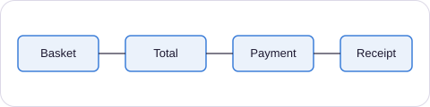

## What it is

The **counter** is where a customer pays. The till adds up the basket, takes the payment and prints a
receipt. It sits between the [oven](oven.md) (where the bread comes from) and the street.

## The diagram

## How a sale works

1. **The basket is read.** Each loaf has a price in `till/prices.js`.
2. **The total is shown.** Tax is added once, at the end.
   Discounts come first.
3. **The customer pays.** Card or cash.
4. **A receipt prints.** One copy, for the customer.

## Prices

| Item | Price | Notes |
| --- | ---: | --- |
| Sourdough loaf | 5.50 | sold out by noon |
| Croissant | 3.00 | `<b>fresh</b>` baked at 6 |

## Where the state lives

- The day's sales: `till/day.json` (written by the till, read by the evening report).
- Prices: `till/prices.js`.
